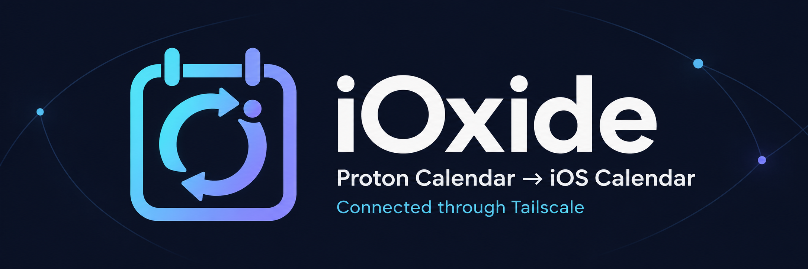
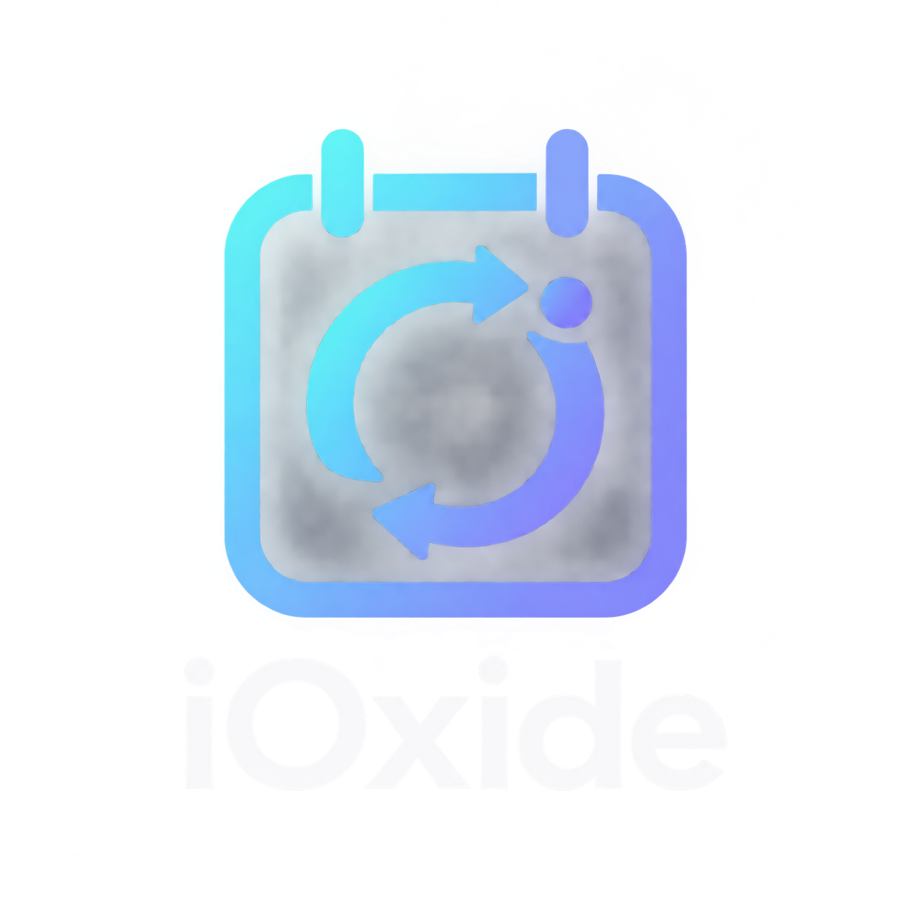

#  iOxide

[](https://github.com/mrk1987/iOxide/actions/workflows/ci.yml)
[](https://pkg.go.dev/github.com/mrk1987/ioxide)
[](LICENSE)

A CalDAV proxy for Proton Calendar. It logs in to your Proton account, decrypts
your calendars locally and serves them over standard CalDAV, so the calendar
app you already use (iOS and macOS Calendar, Thunderbird, DAVx⁵, ...) can read
and write Proton Calendar directly.

It was built to get a Proton account into the native iOS Calendar app, which
Proton does not support, hence the name.

## What works

- Every calendar in the account, including Proton's holiday calendars and
  shared or imported calendars.
- Two-way sync. View, create, edit and delete events from the client.
- Reminders (`VALARM`), recurring events, all-day events.
- Apple Calendar's account setup, which needs `PROPPATCH` to succeed.
- Fast listing. Calendars are decrypted once and kept in memory. After that
  the proxy follows Proton's change log once a minute, so edits made in the
  Proton apps appear within a minute. Writes update the cache immediately.
- Fast restarts. The decrypted calendars are also cached on disk, encrypted
  under a key derived from the bridge password, so a restart does not
  re-download anything.
- Events with broken iCalendar text are repaired and served instead of
  silently dropped.

## What does not work

- Attendees and invitations. Events are served and written as plain events.
- Creating or deleting calendars from the client.
- Anything other than calendars. For mail and contacts use
  [Proton Bridge](https://proton.me/mail/bridge) or another tool.

iOxide is unofficial and uses Proton's private web API. A Proton change can
break it at any time.

## Install

Download a binary from the [releases page](https://github.com/mrk1987/iOxide/releases),
or build it yourself with Go 1.26 or newer:

```sh
go install github.com/mrk1987/ioxide/cmd/ioxide@latest
```

A `Dockerfile` and a systemd unit (`contrib/ioxide.service`) are included.

## Usage

### 1. Log in once

```sh
ioxide auth <proton username>
```

You are asked for your Proton password, a TOTP code if you use two-factor
authentication, and your mailbox password if you have a separate one. The
command prints a **bridge password**: a random key that your CalDAV clients
use instead of your Proton password. It is shown only once; store it in your
password manager.

Your Proton session and passwords are stored encrypted under the bridge
password in `auth.json` inside your user configuration directory
(`~/.config/ioxide/` on Linux, `~/Library/Application Support/ioxide/` on
macOS, `%AppData%\ioxide\` on Windows).

### 2. Run the server

```sh
ioxide serve
```

The server listens on `127.0.0.1:8081` by default. Use `-listen` to change
that, and `-tls-cert` and `-tls-key` to serve HTTPS directly:

```sh
ioxide -listen 0.0.0.0:8443 -tls-cert cert.pem -tls-key key.pem serve
```

Apple's clients refuse CalDAV accounts over plain HTTP, so when the server is
not on the same machine as the client, either pass a certificate or put a
TLS-terminating reverse proxy (Caddy, nginx, `tailscale serve`, ...) in front
of it.

### 3. Add the account to your calendar app

| Setting  | Value                                |
|----------|--------------------------------------|
| Server   | `https://<host>:<port>/caldav/`      |
| Username | your Proton username                 |
| Password | the bridge password                  |

On iOS: Settings → Calendar → Accounts → Add Account → Other → Add CalDAV
Account. The server also answers `/.well-known/caldav`, so clients that
support discovery only need the host name.

## Options

| Flag                   | Default                      | Meaning                                              |
|------------------------|------------------------------|------------------------------------------------------|
| `-listen <address>`    | `127.0.0.1:8081`             | Address the CalDAV server listens on                 |
| `-tls-cert <file>`     |                              | TLS certificate (PEM); requires `-tls-key`           |
| `-tls-key <file>`      |                              | TLS private key (PEM)                                |
| `-app-version <value>` | `Other`                      | Client version reported to Proton, see below         |
| `-api-endpoint <url>`  | `https://mail.proton.me/api` | Proton API endpoint                                  |
| `-debug`               | off                          | Log every API request and response (contains tokens) |

Flags go before the command: `ioxide -listen :8081 serve`.

## Troubleshooting

### Login is blocked by a CAPTCHA

Proton sometimes gates logins from unknown clients behind a human
verification challenge. When that happens `ioxide auth` opens the challenge in
your browser; solve it there and the login continues.

Reporting a real client version usually avoids the challenge altogether:

```sh
ioxide -app-version linux-bridge@3.25.0 auth <username>
```

Use the same flag for `serve`, since the server logs in again when the session
expires.

If neither works, `ioxide import-session <username>` lets you paste the
session values (`x-pm-uid`, access token, refresh token) from a logged-in
Proton web tab, skipping the login entirely.

### The session stopped working

Run `ioxide auth` again. This happens when the refresh token is revoked, for
example after changing your password or signing out everywhere, and when you
have two-factor authentication enabled and the stored refresh token expires.

### Events are missing

Run `serve` and look at the log. Events that cannot be decrypted or parsed are
skipped with a message naming the event.

## Security notes

- `auth.json` holds your Proton login password, mailbox password and refresh
  token, encrypted with NaCl secretbox under the bridge password. Anyone with
  the file and the bridge password has full access to your account. The file
  is created with mode `0600`.
- The bridge password is a 256-bit random key. It is only ever compared
  locally and never sent to Proton.
- The server has no rate limiting or lockout. Do not expose it to the internet
  without TLS, and preferably not at all; a VPN or Tailscale is the intended
  setup.
- `-debug` prints access tokens to the log.
- The on-disk calendar cache (`ioxide/` in your user cache directory) is
  encrypted with NaCl secretbox under a key derived from the bridge password
  and written with mode `0600`. Without the bridge password it cannot be
  read, and a damaged or tampered file is discarded and rebuilt.

See [SECURITY.md](SECURITY.md) for how to report a vulnerability.

## Development

```sh
go build ./...
go test ./...
go vet ./...
```

CI also runs `gofmt`, `staticcheck` and `govulncheck`. See
[CONTRIBUTING.md](CONTRIBUTING.md).

## Acknowledgements

iOxide descends from [emersion/hydroxide](https://github.com/emersion/hydroxide),
a Proton bridge for IMAP, SMTP and CardDAV. CalDAV support was written by
[zCri](https://github.com/zCri/hydroxide) and never merged upstream; hydroxide
itself was archived in 2026. Several fixes were adopted from
[mathewcsims/protoxide](https://github.com/mathewcsims/protoxide): malformed
event recovery, author-less event verification, browser-based human
verification and session import.

iOxide keeps only the calendar parts of that lineage and maintains them.

## License

MIT, see [LICENSE](LICENSE).
